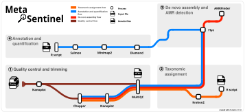

<p align="center">
  
</p>

<h1 align="center">MetaSentinel</h1>
<p align="center"><i>A Metagenomic Workflow for Pathogen Detection and Genomic Surveillance</i></p>

---

[](https://www.nextflow.io/)

[](https://docs.conda.io/en/latest/)

## 1. Introduction 

### 1.1. Overview

**MetaSentinel** is a modular bioinformatics pipeline for pathogen detection and genomic surveillance based on long-read amplicon and shotgun metagenomic sequencing within a One Health framework, encompassing human, animal, and environmental health.

MetaSentinel integrates laboratory and bioinformatics workflows developed to support the detection, characterization, and surveillance of bacteria, fungi, and viruses from complex biological and environmental samples.

The platform combines two complementary sequencing strategies:

1. **Long-amplicon sequencing** for bacterial and fungal identification.
2. **Shotgun metagenomic sequencing** for comprehensive viral identification, characterization and surveillance.

For bacterial and fungal profiling, MetaSentinel is coupled with a multiplex PCR protocol developed by the authors that simultaneously amplifies the full-length **16S rRNA gene (~1,500 bp)** for bacteria and the **ITS-LSU region (~1,500 bp)** for fungi. This approach enables broad-spectrum detection and taxonomic classification of microbial communities using long-read sequencing technologies.

For viral surveillance, MetaSentinel supports shotgun metagenomic sequencing and is compatible with a viral enrichment protocol developed by the authors to improve the recovery and detection of viral nucleic acids from complex samples. This strategy enables the identification of both known and emerging viral pathogens.

MetaSentinel accepts **FASTQ** files generated from long-read sequencing platforms and performs quality control, trimming, taxonomic classification, de novo assembly, taxonomic annotation, abundance quantification, antimicrobial resistance (AMR) gene detection, and automated report generation.

---

### 1.2. Workflow

The pipeline begins with quality assessment of raw sequencing reads using **NanoPlot**. Reads are subsequently filtered and trimmed with **Chopper** to remove low-quality regions and sequencing artifacts. Following trimming, a second quality control step is performed using NanoPlot to evaluate the quality of the processed reads. All quality control metrics and reports generated throughout the workflow are automatically aggregated into a comprehensive report using **MultiQC**.

#### 1.2.1. Read-Based Taxonomic Classification

By default, MetaSentinel executes a read-based taxonomic classification workflow. In this approach, quality-filtered reads are classified against curated taxonomic databases using **Kraken2**. The resulting taxonomic profiles are summarized and visualized through automated **R** scripts, providing rapid identification and abundance estimation of microorganisms present in the sample.

This workflow is particularly suitable for long-amplicon sequencing datasets generated from the multiplex bacterial and fungal detection protocol.

#### 1.2.2. Assembly-Based Characterization (Shotgun Metagenomics)

Optionally, users can enable the assembly-based workflow designed for shotgun metagenomic datasets.

In this workflow, high-quality reads are assembled *de novo* using **Flye**. The resulting contigs are taxonomically annotated through similarity searches against curated protein and viral databases using **Diamond**. Sequencing reads are then mapped back to assembled contigs using **Minimap2**, enabling abundance estimation with **Salmon**.

Taxonomic composition, abundance profiles, and graphical summaries are automatically generated through **R** scripts. In parallel, antimicrobial resistance genes are identified using **AMRFinderPlus**, providing additional insights into the resistome of the analyzed sample.

---

### 1.3. Input

* FASTQ files generated from long-read sequencing (Oxford Nanopore platforms)

---

### 1.4. Output

MetaSentinel automatically generates a structured results directory containing all files produced during the analysis, including:

* Quality control reports;
* Trimmed sequencing reads;
* Taxonomic classification results;
* De novo assemblies;
* Contig annotation files;
* Abundance quantification tables;
* Integrated MultiQC report;
* Antimicrobial resistance reports.

The generated outputs are suitable for clinical diagnostics, outbreak investigations, environmental monitoring, veterinary surveillance, food safety applications, and large-scale genomic surveillance programs.

---

### 1.5. Applications

MetaSentinel was designed to support:

* Clinical pathogen detection;
* Hospital surveillance;
* Environmental surveillance;
* Veterinary and wildlife surveillance;
* Food safety investigations;
* Outbreak investigation and response;
* Antimicrobial resistance monitoring;
* One Health genomic surveillance programs.

---
  
<p align="center">
  
</p>


## 2. Dependencies
The pipeline requires the following dependencies: 

[](https://www.nextflow.io/)
[](https://seqera.io/multiqc/)
[](https://www.r-project.org/)
[](https://ggplot2.tidyverse.org/)
[](https://readr.tidyverse.org/)
[](https://dplyr-tidyverse-org.translate.goog/?_x_tr_sl=en&_x_tr_tl=pt&_x_tr_hl=pt&_x_tr_pto=tc)

[](https://github.com/mikolmogorov/Flye)
[](https://github.com/wdecoster/chopper) 
[](https://minimap2.com/)
[](https://combine-lab.github.io/salmon/)
[](https://github.com/bbuchfink/diamond)
[](https://github.com/DerrickWood/kraken2)
[](https://github.com/wdecoster/nanoplot)
[](https://github.com/ncbi/amr)

## 3. Installation

MetaSentinel requires only **Conda** and **Nextflow** to be installed on the system. All bioinformatics software dependencies are automatically downloaded and configured during the first pipeline execution through Conda environments managed by Nextflow.

### 3.1. Install Conda

If Conda is not already installed, install either:

* **Miniconda** (recommended)
* **Anaconda**

Verify the installation:

```bash
conda --version
```

### 3.2. Create a MetaSentinel Environment

Create and activate a dedicated environment for running MetaSentinel:

```bash
conda create -n metasentinel -y
conda activate metasentinel
```

### 3.3. Install Nextflow

Install Nextflow using Conda:

```bash
conda install -c bioconda nextflow -y
```

Verify the installation:

```bash
nextflow -version
```

### 3.4. Download MetaSentinel

```bash
git clone https://github.com/lmrtome/MetaSentinel.git
cd MetaSentinel
```

During the first execution, Nextflow automatically creates all required Conda environments and installs the necessary software packages, including:

* **NanoPlot;**
* **Chopper;**
* **MultiQC;**
* **Kraken2;**
* **Flye;**
* **Diamond;**
* **Minimap2;**
* **Salmon;**
* **AMRFinderPlus;**
* **R** and required packages.

This setup process occurs only once. Subsequent executions will reuse the previously created environments, resulting in significantly faster startup times.

### 3.5. System Requirements

* Linux (recommended)
* macOS (experimental support)
* Conda (Miniconda)
* Nextflow ≥ 24.x
* Internet connection for the first execution
* Sufficient storage space for sequencing data, databases, and results

No manual installation of individual bioinformatics tools is required.

## 4. Usage

### 4.1. Input data structure

Prepare a directory containing your Oxford Nanopore sequencing data in FASTQ format as shown below:

```text
samples/
├── sample_1.fastq.gz
├── sample_2.fastq.gz
├── sample_3.fastq.gz
└── ...
```

All files in the input directory must be compressed FASTQ files (`*.fastq.gz`) generated from Oxford Nanopore long-read sequencing.

### 4.2. Read-Based Taxonomic Classification (Default Workflow)

Run MetaSentinel using Kraken2-based taxonomic classification:

```bash
nextflow run main.nf \
    --input /path/to/reads \
    --database_kraken2 /path/to/kraken2_database
```

### 4.3. Assembly-Based Characterization (Shotgun Metagenomics)

To enable de novo assembly, taxonomic annotation, abundance estimation, and antimicrobial resistance detection, set **--run_assembly true*;* and provide the additional databases required for the assembly workflow:

```bash
nextflow run main.nf \
    --run_assembly true \
    --input /home/user/reads \
    --threads 10 \
    --headcrop 30 \
    --phredscore 10 \
    --minlen 100 \
    --database_kraken2 /databases/metasentinel_multiplex_database \
    --database_diamond /databases/diamond/uniprot_sprot_tax.dmnd \
    --taxa_names /databases/diamond/names.dmp \
    --database_amrfinder /databases/amrfinder/latest \
    --read_type nano-hq \
    -output-dir /home/user/MetaSentinel_results
```

### 4.4. Optional Parameters

To resume a previous execution and avoid reprocessing completed steps:

```bash
nextflow run main.nf \
    --input /path/to/reads \
    --database /path/to/kraken2_database \
    -resume
```

### 4.5. Parameters

| Parameter | Description | Default |
|------------|------------|----------|
| `--input` | Directory containing Oxford Nanopore FASTQ files (`*.fastq.gz`) | Required |
| `-output-dir` | Directory where pipeline results will be stored | `MetaSentinel_results` |
| `--threads` | Number of CPU threads | `4` |
| `--headcrop` | Number of bases removed from the beginning of each read | `30` |
| `--phredscore` | Minimum Phred quality score retained after filtering | `10` |
| `--minlen` | Minimum read length after filtering | `100` |
| `--database_kraken2` | Path to the Kraken2 database | Required |
| `--database_diamond` | Path to a Diamond-formatted database (`.dmnd`) | Assembly workflow |
| `--taxa_names` | Path to the NCBI taxonomy `names.dmp` file used for annotation | Assembly workflow |
| `--database_amrfinder` | Path to the AMRFinderPlus database directory | Assembly workflow |
| `--read_type` | Flye read type (`nano-raw`, `nano-corr`, `nano-hq`) | `nano-hq` |

### 4.6. Flye Read Types

The `--read_type` parameter specifies the Oxford Nanopore read category used during de novo assembly with Flye.

| Value | Description |
|---------|-------------|
| `nano-raw` | Raw Oxford Nanopore reads |
| `nano-corr` | Error-corrected Oxford Nanopore reads |
| `nano-hq` | High-quality Oxford Nanopore reads (recommended for R10.4.1 chemistry, SUP basecalling, duplex reads, and Q20+ datasets) |

### 4.7. Database Structure Example

```text
databases/
├── metasentinel_multiplex_database/
├── diamond/
│   ├── uniprot_sprot_tax.dmnd
│   └── names.dmp
└── amrfinder/
    └── latest/
```

### 4.8. Notes

- Kraken2-based taxonomic classification is performed for all analyses.
- Flye, Diamond, Minimap2, Salmon, and AMRFinderPlus are executed when the option **--run_assembly true*;* and assembly databases are provided.
- Use `-resume` to continue interrupted analyses and avoid reprocessing completed steps.
- During the first execution, MetaSentinel automatically creates all required Conda environments.
- Subsequent executions reuse previously created environments, resulting in significantly faster startup times.                   |

## 5. Pipeline Output

Pipeline results are stored in the output directory specified by `-output-dir`. The directory structure is organized as follows:

```text
MetaSentinel_results/
├── abundance/          # Abundance plots and summary tables
├── abundance_output/   # Salmon quantification results
├── amrfinder/          # Antimicrobial resistance gene detection
├── annotation/         # Contig taxonomic and functional annotation
├── assembly/           # De novo assembly results
├── mapping/            # Read-to-contig alignment files
├── multiqc_report/     # MultiQC summary report
├── qc/                 # Raw and trimmed read quality control reports
├── taxonomy/           # Taxonomic classification and plots
└── trimmed/            # Quality-filtered reads
```

The exact output structure may vary depending on the selected workflow options and whether the assembly module is enabled.

## 6. Contact and Support

If you encounter any issues, unexpected results, or have suggestions for improving MetaSentinel, please feel free to contact the developers or open an issue in the GitHub repository.

### Developers

**Luiz Marcelo Ribeiro Tomé (UFRJ)**

📧  E-mail: [lmarcelotome@gmail.com](mailto:lmarcelotome@gmail.com)

**Luccas Pereira da Rocha Badiani Silva (UFRJ/UERJ)**

We welcome bug reports, feature requests, and feedback from the community to help improve MetaSentinel.
